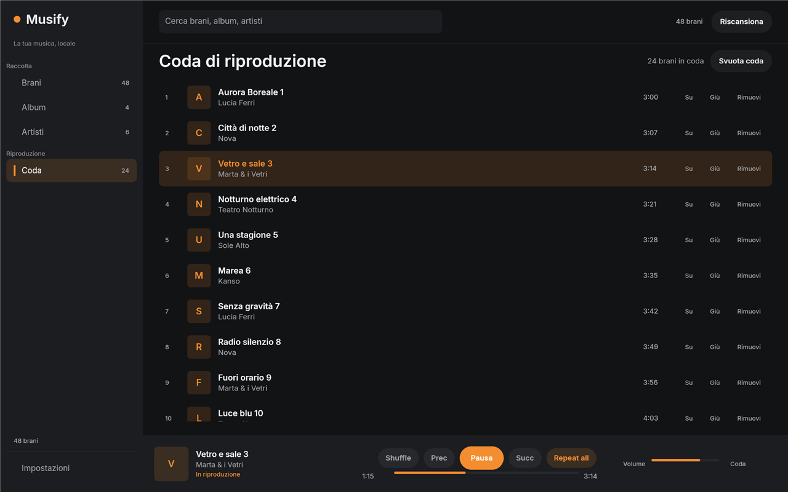
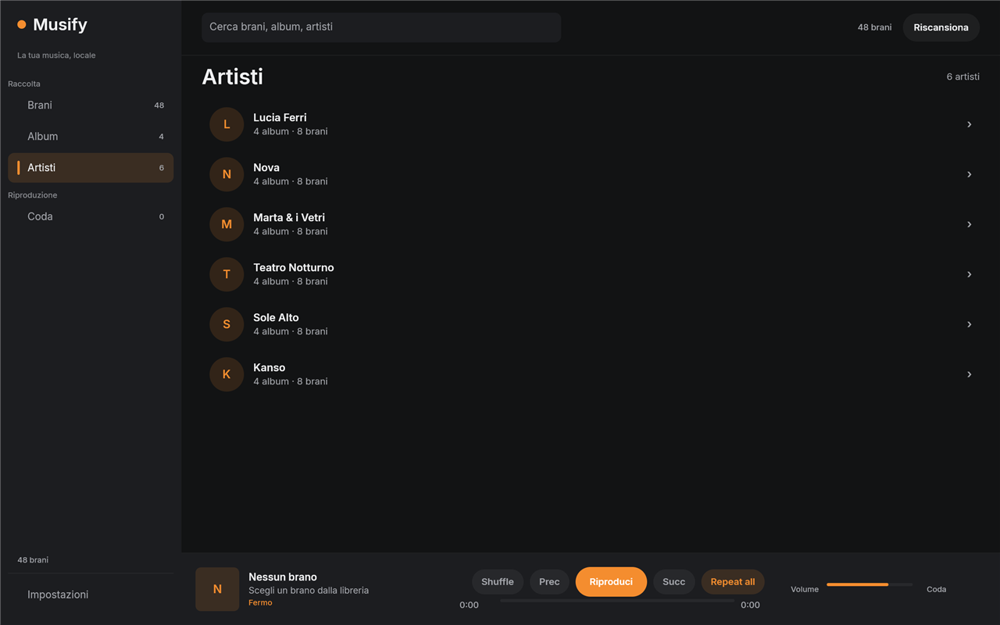
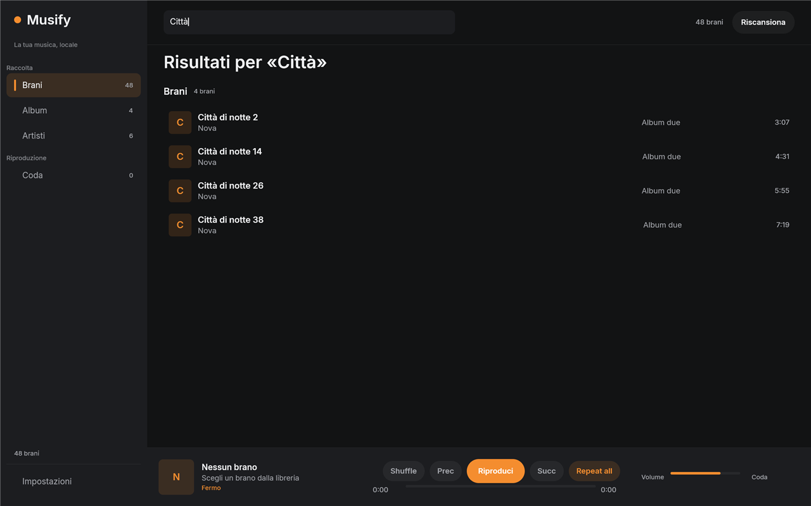
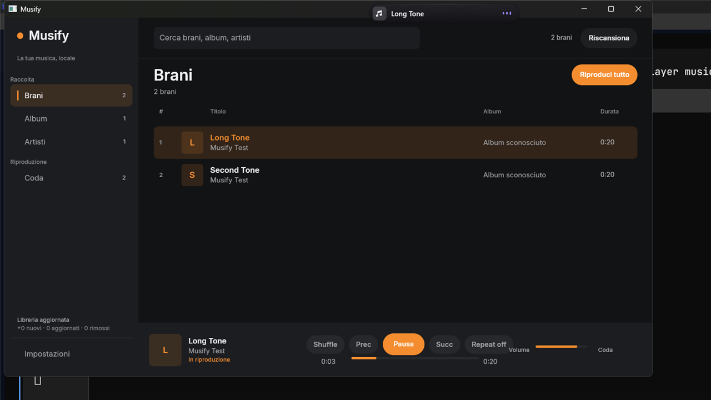
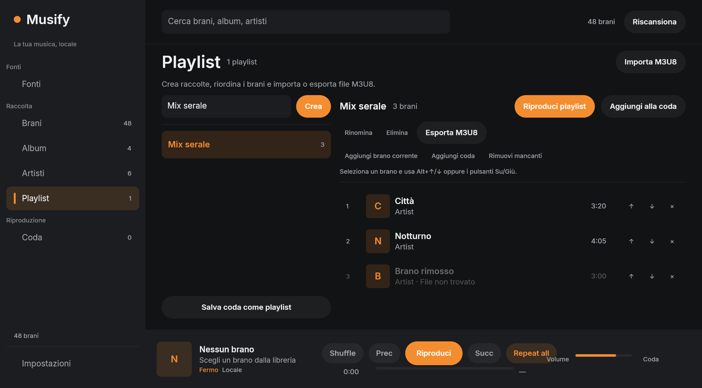
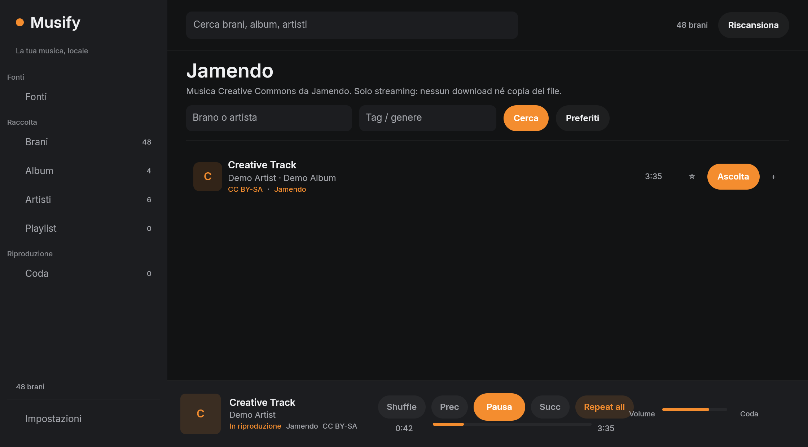
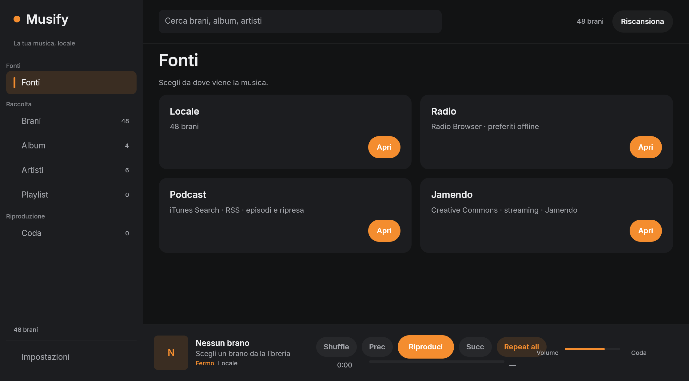
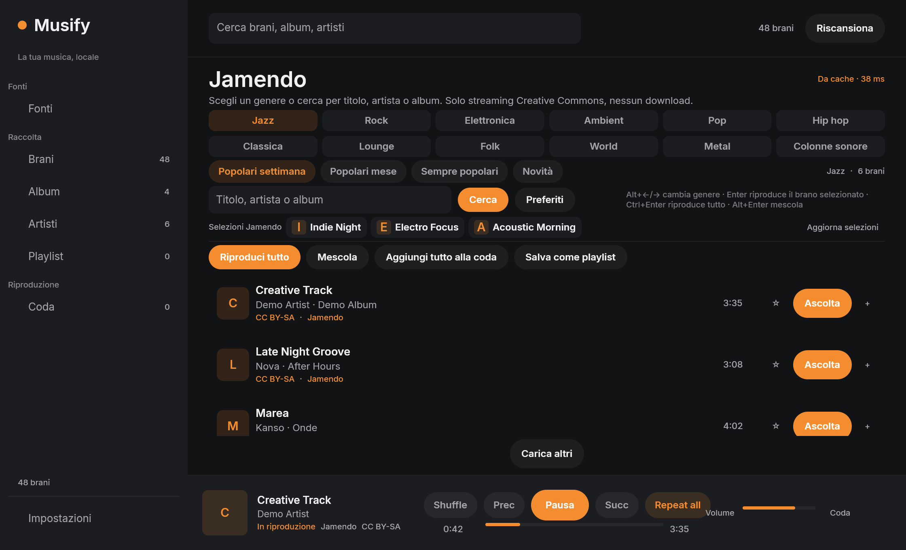

<p align="center">
  
</p>

<p align="center">
  <strong>Il tuo player musicale desktop per Windows.</strong><br>
  Leggero, locale, veloce. Costruito in Rust con una UI GPU Rune.
</p>

<p align="center">
  <a href="https://github.com/Marcu08/musify/actions/workflows/ci.yml"></a>
  
  
  
  
</p>

<p align="center">
  
</p>

## Musify in breve

Musify è un player musicale per Windows pensato per la **musica locale**:
cartelle scelte da te, scansione incrementale, copertine, ricerca istantanea,
coda, shuffle/repeat e una barra "in riproduzione" sempre pronta. Niente
abbonamenti, niente catalogo cloud, niente rumore: solo i tuoi file.

L'interfaccia è scura, con un accento ambra; il motore audio e la libreria sono
completamente separati dalla UI. Rune è una dipendenza sperimentale, pinnata a
un commit preciso e confinata al crate `musify-ui`.

## Funzionalità

- **Libreria locale**: cartelle musicali multiple, scansione incrementale,
  metadati con `lofty`, rimozione automatica dei file spariti.
- **Ricerca FTS5**: brani, album e artisti, con supporto agli accenti
  (`citta` trova `Città`).
- **Viste virtualizzate**: Brani, Album e Artisti costruiscono solo le righe
  visibili; la UI resta fluida anche con librerie grandi.
- **Riproduzione**: play/pausa, precedente/successivo, seek, volume,
  shuffle, repeat, coda modificabile.
- **Gapless**: i sample del brano successivo entrano nello stesso stream; il
  cambio metadati segue il confine di frame. Nessun crossfade.
- **Radio internet**: sezione Fonti con Radio Browser (nome, paese, genere/tag),
  preferiti locali, streaming MP3/AAC/Ogg con buffer adattivo, riconnessione e
  riapertura del decoder Ogg, metadati ICY, favicon in cache limitata e badge
  della fonte. HLS non è supportato e viene rifiutato con un errore chiaro.
- **Fonti astratte (M5.2)**: radio e podcast implementano `SourceProvider` nel
  core (schema, ricerca, preferiti/iscrizioni, risoluzione Live/OnDemand).
  L'app instrada le richieste con un registro per schema; comandi ed eventi
  della UI non nominano più la singola fonte.
- **Podcast (M6.1)**: ricerca con iTunes Search, parsing RSS con `feed-rs`,
  iscrizioni, elenco episodi con data/durata/descrizione, stato ascoltato e
  posizione di ripresa in SQLite. I feed si aggiornano solo su richiesta.
- **Playlist (M7.1)**: raccolte locali con elementi generici per fonte, snapshot
  di titolo/artista/album/durata/copertina, riordino con pulsanti e Alt+↑/↓,
  import/export M3U8 UTF-8. I file mancanti restano visibili in grigio e vengono
  saltati in riproduzione. Radio e podcast restano fuori dalle playlist.
- **Jamendo (M7.2/M7.4)**: fonte `jamendo://` tramite `SourceProvider`, ricerca
  per brano/artista/tag, streaming MP3 OnDemand con seek quando il server lo
  consente, cache risultati 24 h, preferiti SQLite, copertine limitate e
  attribuzione Creative Commons con link a Jamendo. Richiede
  `MUSIFY_JAMENDO_CLIENT_ID`; senza chiave la fonte non compare e la UI spiega
  come configurarla. Solo streaming: nessun download.
- **Jamendo veloce (M7.4)**: home a 12 generi con etichette italiane,
  ordinamento Popolari settimana/mese/sempre e Novità, ricerca per testo
  combinata con genere e ordinamento, paginazione a 60 brani con lista
  virtualizzata, azioni rapide (riproduci tutto, mescola, aggiungi alla coda,
  salva come playlist), selezioni curate Jamendo, cache-first 24 h con
  precaricamento una tantum dei generi più usati, richieste annullabili e
  latenza visibile. Un clic su un genere basta per ascoltare.
- **HTTP Range**: gli episodi MP3/AAC con `Accept-Ranges` sono seekable tramite
  richieste `Range`; la riconnessione riparte dall’offset in byte. Se il server
  non supporta Range, l’episodio resta riproducibile ma la UI indica che non è
  seekable.
- **Indagine CPU M5.1**: i ridisegni sono stati strumentati; durante la
  riproduzione Rune presenta a ~60 fps mentre i commit logici sono pochi. Le
  varianti provate (coalescing, `Tx::instant`, `Tx::settle`, wake throttling)
  non hanno dato un guadagno riproducibile e sono state rimosse. Dettagli e
  misure oneste in [M5.1](docs/M51-REPORT.md).
- **Windows-native**: SMTC, overlay di Windows, tasti multimediali, dialog
  nativo per scegliere le cartelle.
- **Qualità della vita (M8)**: profilo di build `fast` per l'uso quotidiano,
  icona e informazioni di versione nell'exe, installazione locale con collegamenti
  desktop/menu Start e log su file con rotazione (senza terminale).
- **Persistenza**: coda, brano corrente e posizione in `state.json`; cartelle,
  volume, shuffle e repeat in `config.toml`. Gli stream radio non vengono
  salvati.
- **Scorciatoie**: Spazio, frecce, Ctrl+F, Ctrl+R, +/−, Esc, Ctrl+Q.
- **Misure trasparenti**: i numeri reali sono riportati sotto, inclusi i target
  che non sono stati raggiunti.

## Screenshot

| Brani | Coda |
| --- | --- |
|  |  |

| Album | Artisti |
| --- | --- |
|  |  |

| Ricerca | Impostazioni |
| --- | --- |
|  |  |

| Ripristino coda | Overlay Windows |
| --- | --- |
|  |  |

| Playlist |
| --- |
|  |

| Jamendo | Fonti |
| --- | --- |
|  |  |

| Jamendo veloce (M7.4) |
| --- |
|  |

## Requisiti

- Windows 10/11 x86_64.
- [rustup](https://rustup.rs/) con toolchain MSVC. Il repository fissa
  **Rust 1.99.1** in `rust-toolchain.toml`, la stessa versione richiesta da Rune.
- Visual Studio Build Tools con **Desktop development with C++**.
- Driver GPU con DirectX 12 (Rune usa wgpu).
- Facoltativo: `ffmpeg` nel `PATH` per rigenerare gli asset audio di test.

## Avvio rapido

```powershell
git clone https://github.com/Marcu08/musify.git
cd musify

cargo build -p musify --release
.\target\release\musify.exe
```

Al primo avvio apri **Impostazioni → Aggiungi cartella**, scegli la cartella
della tua musica e lascia che la scansione parta. La libreria viene aggiornata
automaticamente quando i file cambiano.

### Profili di build

| Profilo | Comando | Quando usarlo |
| --- | --- | --- |
| `dev` | `cargo run -p musify` | sviluppo e debug, nessuna ottimizzazione |
| `fast` | `cargo build -p musify --profile fast` → `target\fast\musify.exe` | uso quotidiano: thin LTO e 16 codegen unit, compila molto più in fretta di `release`; l'exe è un po' più grande e leggermente meno veloce |
| `release` | `cargo build -p musify --release` → `target\release\musify.exe` | distribuzione: fat LTO, 1 codegen unit, strip; il più piccolo e veloce, ma il più lento da compilare |

`cargo run -p musify --profile fast` funziona per una prova rapida. I tempi
misurati sono in [docs/M8-REPORT.md](docs/M8-REPORT.md).

## Installazione locale

```powershell
cargo build -p musify --release
powershell -ExecutionPolicy Bypass -File .\scripts\install-local.ps1
```

Lo script copia `musify.exe` in `%LOCALAPPDATA%\Musify`, crea il collegamento sul
desktop e nel menu Start con l'icona dell'exe, e non richiede privilegi di
amministratore. Non tocca `%APPDATA%\Musify`: configurazione, coda, cache e log
restano dove sono.

- Per aggiornare: ricompila e riesegui lo stesso script. Chiudi prima Musify, se
  è aperto.
- `-Profile fast` installa `target\fast\musify.exe`.
- `-WhatIf` mostra le operazioni senza eseguirle; `-Source <percorso>` installa
  un eseguibile specifico.

Per lo sviluppo:

```powershell
cargo run -p musify
```

Controlli locali equivalenti alla CI:

```powershell
powershell -ExecutionPolicy Bypass -File .\scripts\ci.ps1
```

### Hook Git

Il repository include hook versionati in `.githooks/`. Attivali una volta per
clone:

```powershell
git config core.hooksPath .githooks
```

Il `pre-commit` esegue lo scan segreti (`scripts/check-secrets.ps1`) e
`cargo fmt --all -- --check`; il `pre-push` esegue lo scan sull'intero albero,
clippy e test. Se il push contiene **solo tag** (`refs/tags/*`), clippy e test
vengono saltati: il codice non cambia. Su macchine con poca RAM si può impostare
`$env:MUSIFY_CARGO_JOBS = "1"` per limitare la concorrenza; senza la variabile
Cargo usa tutti i core. Su Windows gli hook girano con Git Bash e richiamano
PowerShell per lo scan. Dettagli e regole di sicurezza in
[docs/GIT-WORKFLOW.md](docs/GIT-WORKFLOW.md).

## Scorciatoie

| Tasto | Azione |
| --- | --- |
| `Spazio` | Play / pausa |
| `←` / `→` | Seek ±5 secondi |
| `Ctrl+←` / `Ctrl+→` | Brano precedente / successivo |
| `Alt+↑` / `Alt+↓` | Sposta il brano selezionato nella playlist |
| `Alt+←` / `Alt+→` | Jamendo: genere precedente / successivo |
| `Enter` | Jamendo: riproduci il brano selezionato |
| `Ctrl+Enter` | Jamendo: riproduci tutto |
| `Alt+Enter` | Jamendo: mescola e riproduci |
| `Ctrl+F` | Cerca |
| `Ctrl+R` | Riscansiona la libreria |
| `+` / `-` | Volume su / giù |
| `Esc` | Chiude ricerca o filtro |
| `Ctrl+Q` | Chiude Musify |

## Architettura

```text
┌──────────────────────┐   Command    ┌────────────────────┐
│      UI (Rune)       │ ───────────▶ │    AppBackend      │
│  liste virtuali      │              │  coda, config,     │
│  barra now-playing   │ ◀─────────── │  persistenza       │
└──────────────────────┘    Event     └─────────┬──────────┘
                                                │
                    ┌───────────────────────────┼───────────────────────────┐
                    ▼                           ▼                           ▼
             ┌────────────┐             ┌────────────┐             ┌────────────┐
             │ AudioEngine│             │  Library   │             │    SMTC    │
             │ symphonia  │             │  SQLite    │             │  souvlaki  │
             │ cpal/WASAPI│             │  FTS5      │             │  Windows   │
             └────────────┘             └────────────┘             └────────────┘
```

| Crate | Responsabilità |
| --- | --- |
| `musify-core` | tipi di dominio, `Command`/`Event`, trait `SourceProvider` e `LibraryProvider` |
| `musify-audio` | decodifica, output, coda, seek, volume, gapless |
| `musify-library` | scanner incrementale, SQLite, ricerca, copertine, watcher, playlist |
| `musify-radio` | `SourceProvider` Radio Browser, cache e preferiti SQLite |
| `musify-podcast` | `SourceProvider` iTunes Search, RSS, iscrizioni/episodi SQLite |
| `musify-jamendo` | `SourceProvider` Jamendo, cache/preferiti SQLite, copertine |
| `musify-ui` | presentazione Rune, nessuna logica di dominio |
| `musify-app` | binario, config, registro fonti, SMTC, persistenza, coda |

Dettagli completi in [ARCHITECTURE.md](ARCHITECTURE.md).

## Misure reali

Release, Windows 11, Ryzen 5 5625U (6 core / 12 thread), 7,3 GB RAM,
cache shader calda. Non sono numeri di laboratorio: sono le misure fatte su
questa macchina.

| Area | Risultato | Target indicativo |
| --- | --- | --- |
| Audio engine da solo | **0,93% di un core**, 15,9 MB, 0 underrun | < 2% |
| Resampler sinc 44,1 → 48 kHz | **1,25% di un core** (lineare: 0,31%), 0 underrun | < 2% |
| Libreria, 10.000 file | **8,51 s** prima scansione, **0,98 s** incrementale | — |
| UI a riposo | **0,00% CPU** su 5 s, nessun redraw | zero wake-up |
| UI in riproduzione locale | **6,55% di un core**, **0,55%** su 12 thread | < 2% |
| Radio MP3 128 kbps | **7,65% di un core**, **0,64%** su 12 thread | < 2% |
| Podcast MP3 con Range | **8,58% di un core**, **0,71%** su 12 thread | < 2% |
| Avvio app completa M7.1 | **1,49 s** mediana (min 1,48, max 2,38); baseline stessa sessione 2,04 s | < 300 ms |
| RAM M7.1 | private bytes **169,9 MB** a riposo (baseline 170,6); working set variabile (124,7 MB nell'ultima serie) | < 80 MB |

I target di **avvio** e **RAM** non sono stati raggiunti: Rune/wgpu e
l'inizializzazione GPU sono la parte dominante. La UI a riposo non ridisegna.
Tutti i dettagli e i problemi noti sono nei report delle milestone; il metodo e
i valori grezzi sono in [M45-BASELINE](docs/M45-BASELINE.md) e
[M45-FINAL](docs/M45-FINAL.md). Per M7.1 la baseline `aca8763` è stata misurata
nella stessa sessione: avvio e private bytes non mostrano un aumento misurabile,
mentre il working set varia con la cache shader e con i trim di Windows. La CPU
di riproduzione locale nella sessione M7.1 è 9,51% di un core (baseline 9,67%):
il percorso audio non è cambiato. Dettagli in
[M7.1](docs/M71-PLAYLIST-REPORT.md).

Per M7.2, senza chiave Jamendo i private bytes a riposo restano 170,2 MB; con la
chiave configurata salgono a 171,6 MB (+1,4 MB per la connessione SQLite e il
provider) e lo startup misurato è 1,62 s (1,91 s senza chiave nella stessa
serie). La fonte non crea runtime di rete all'avvio. Dettagli e valori grezzi in
[M7.2](docs/M72-JAMENDO-REPORT.md).

Per M7.4, su un server finto con 40 ms di ritardo simulato, la stessa ricerca
da 100 risultati passa da 62,4 ms (cache calda M7.2, network-first) a 4–6 ms
(cache-first M7.4); il primo clic su un genere precaricato è 3,5–3,8 ms. La
cache fredda resta dominata dalla rete (64–65 ms). Metodo e limiti in
[M7.4](docs/M74-JAMENDO-UX-REPORT.md).

Per M8, build pulita e incrementale misurate in target directory isolate:

| Metrica | `fast` | `release` |
| --- | ---: | ---: |
| Build pulita | 10m22,5 | 22m00,5 |
| Build incrementale | 3m14,6 | 9m35,1 |
| Eseguibile | 37,24 MB | 33,34 MB |
| Avvio ready | 1,73 s | 1,78 s |
| CPU in riproduzione | 9,36% di un core | 9,04% di un core |

Le differenze di avvio e CPU sono dentro la varianza delle 10 esecuzioni; il
profilo `fast` è equivalente all'uso quotidiano, il `release` resta quello di
distribuzione. Dettagli, hash di riproducibilità e valori grezzi in
[M8](docs/M8-REPORT.md).

## Milestone

| Milestone | Stato | Report |
| --- | --- | --- |
| M0 — Workspace e smoke test Rune | completata | [M0](docs/M0-RUNE-REPORT.md) |
| M1 — Motore audio | completata | [M1](docs/M1-AUDIO-REPORT.md) |
| M2 — Libreria | completata | [M2](docs/M2-LIBRARY-REPORT.md) |
| M3 — UI Rune | completata | [M3](docs/M3-UI-REPORT.md) |
| M4 — Windows, SMTC, persistenza | completata | [M4](docs/M4-WINDOWS-REPORT.md) |
| M4.5 — Prestazioni e qualità locale | completata | [M4.5](docs/M45-REPORT.md) |
| M5 — Fonti online e radio internet | completata | [M5](docs/M5-RADIO-REPORT.md) |
| M5.1 — Rifinitura CPU e radio | radio completata; CPU non ridotta | [M5.1](docs/M51-REPORT.md) |
| M5.2 — Pulizia e astrazione fonti | completata | [M5.2](docs/M52-REPORT.md) |
| M6.1 — Podcast e HTTP Range | completata | [M6.1](docs/M61-PODCAST-REPORT.md) |
| M7.1 — Playlist | completata | [M7.1](docs/M71-PLAYLIST-REPORT.md) |
| M7.2 — Jamendo | completata | [M7.2](docs/M72-JAMENDO-REPORT.md) |
| M7.4 — Jamendo veloce da usare | completata | [M7.4](docs/M74-JAMENDO-UX-REPORT.md) |
| M8 — Qualità della vita | completata | [M8](docs/M8-REPORT.md) |

## Sviluppo

```powershell
# Tutti i test del workspace
cargo test --workspace --all-features

# Solo il motore audio
cargo test -p musify-audio

# Solo la libreria
cargo test -p musify-library

# CLI di prova
cargo run -p musify-audio --bin audio-cli -- .\crates\audio\tests\assets\tone.flac
cargo run -p musify-library --bin library-cli -- scan .\crates\audio\tests\assets
```

Gli asset audio di test sono minuscoli e già nel repository. Per rigenerarli:
`scripts/make-test-assets.ps1` (richiede ffmpeg).

Variabili utili per test isolati: `MUSIFY_DATA_DIR`, `MUSIFY_MUSIC_DIRS`
(separate da `;`), `MUSIFY_NO_AUDIO=1`, `MUSIFY_NO_SMTC=1`, `RUNE_READY_DIR`,
`MUSIFY_AUTOPLAY_RADIO=<url>`, `MUSIFY_AUTOPLAY_PODCAST=<url>`,
`MUSIFY_JAMENDO_CLIENT_ID=<client id>` (obbligatoria per la fonte Jamendo),
`MUSIFY_JAMENDO_API_URL=<url>` e `MUSIFY_JAMENDO_CACHE_TTL_HOURS=<ore>`
(queste ultime solo per test/sviluppo).

## Dati dell'applicazione

| File | Contenuto |
| --- | --- |
| `%APPDATA%\Musify\config.toml` | cartelle musicali, volume, shuffle, repeat |
| `%APPDATA%\Musify\state.json` | coda, brano corrente, posizione |
| `%APPDATA%\Musify\library.sqlite3` | indice della libreria, playlist e elementi |
| `%APPDATA%\Musify\covers\` | cache copertine JPEG |
| `%APPDATA%\Musify\radio.sqlite3` | cache ricerche e stazioni preferite |
| `%APPDATA%\Musify\radio-icons\` | favicon radio, massimo 256 file / 16 MB |
| `%APPDATA%\Musify\podcasts.sqlite3` | iscrizioni, episodi, ascoltato e ripresa |
| `%APPDATA%\Musify\podcast-covers\` | copertine podcast, massimo 64 file / 8 MB |
| `%APPDATA%\Musify\jamendo.sqlite3` | cache ricerche, preferiti, uso dei generi e selezioni Jamendo |
| `%APPDATA%\Musify\jamendo-covers\` | copertine Jamendo, massimo 64 file / 8 MB |
| `%APPDATA%\Musify\logs\musify.log` | log applicativi; file corrente più archivio, 2 MB per file e massimo 5 file |

## Limiti noti

- I target di avvio (< 300 ms) e RAM (< 80 MB) non sono centrati su questa
  macchina; i numeri reali sono sopra e i target realistici sono nel report
  M4.5.
- Su Windows a DPI 125% la prima finestra viene corretta al primo `on_ready`
  per allineare viewport e finestra nativa. L'ultimo `dev` di Rune è stato
  controllato: non contiene una correzione pertinente, quindi il rev resta
  pinnato e il workaround resta attivo.
- Il resampling è sinc (rubato) con fallback lineare tramite
  `MUSIFY_LINEAR_RESAMPLER=1`. Il costo CPU misurato è più alto del lineare ma
  resta sotto il 2% di un core per l'audio engine.
- Modificare o spostare la coda mentre il brano successivo è già decodificato
  ora svuota ring buffer e decodifica prima di riaprire il brano corrente; è
  coperto da test con un finto callback audio.
- Il dialogo nativo delle cartelle non è stato automatizzato nei test desktop;
  la configurazione via TOML e variabili d'ambiente è verificata. La checklist
  manuale è in [docs/MANUAL-CHECKLIST.md](docs/MANUAL-CHECKLIST.md).
- La radio usa stream HTTP progressivi MP3/AAC/Ogg. HLS non è supportato; una
  stazione HLS fallisce con un errore chiaro.
- La riconnessione radio è coperta da test sul trasporto HTTP e sui metadati, non
  da una prova di più ore. Per Ogg un cambio di stream a metà può richiedere un
  riavvio del decoder.
- La cache delle ricerche radio scade dopo 7 giorni; le favicon sono limitate a
  256 file / 16 MB. Senza rete e senza cache valida la ricerca mostra l'errore.
- I podcast non hanno polling in background: ricerca, feed e copertine si
  aggiornano solo quando l'utente apre un podcast, si iscrive o preme Aggiorna.
- Il seek podcast richiede un server HTTP con `Accept-Ranges: bytes`. Senza
  Range l'episodio parte ma la barra è disabilitata e la UI mostra
  `Stream non seekable`.
- Le playlist accettano brani locali e Jamendo; radio e podcast restano esclusi.
- L'import M3U8 crea una nuova playlist dal nome del file; non unisce a una
  playlist esistente. I percorsi relativi sono risolti rispetto al file M3U8 e
  le righe con schema URI (`http://`, `jamendo://`, …) vengono ignorate.
- Il riordino delle playlist usa i pulsanti ↑/↓ e `Alt+↑`/`Alt+↓`; il drag del
  mouse non è previsto.
- I metadati nelle playlist sono snapshot: se i tag del file cambiano, la
  playlist non si aggiorna da sola.
- Il registro fonti contiene radio, podcast e Jamendo; non ci sono client API o
  flussi non implementati.
- Jamendo richiede `MUSIFY_JAMENDO_CLIENT_ID`: senza chiave la fonte non compare
  e la vista Fonti mostra come configurarla. La chiave non viene mai salvata nel
  repository, nei log o negli screenshot.
- Jamendo è usato solo per uso personale/non commerciale, entro i limiti
  dell'API (1 richiesta/s nel client, backoff su 429/5xx, cache 24 h). Non
  vengono mai usati `audiodownload`/`audiodownload_allowed`: solo l'URL `audio`
  in streaming, senza copiare i file su disco.
- Il profilo `fast` è pensato per l'uso quotidiano, non per la distribuzione:
  thin LTO e 16 codegen unit compilano più in fretta, ma l'exe è più grande e
  leggermente meno veloce del `release`. Il profilo `release` resta invariato.
- L'installazione locale copia solo l'exe in `%LOCALAPPDATA%\Musify` e crea due
  collegamenti; non crea servizi, non richiede admin e non modifica
  `%APPDATA%\Musify`. Se Musify è aperto, l'aggiornamento dell'exe può fallire:
  chiudere l'app e rieseguire lo script.
- I log su file ruotano a 2 MB per file, con massimo 5 file. I target HTTP
  rumorosi sono limitati a `warn` anche con `RUST_LOG`, per non far finire URL
  con il client id nei log.
- La home Jamendo usa 12 generi; i tag sono quelli accettati dall'API, le
  etichette sono in `i18n.rs`. Gli ordinamenti sono `popularity_week`,
  `popularity_month`, `popularity_total` e `releasedate_desc`. `limit` è
  paginato a 60 e l'API accetta al massimo 200 risultati per richiesta.
- Le ricerche Jamendo sono cache-first entro 24 h; il pulsante Cerca forza una
  richiesta fresca. Il precaricamento dei generi più usati parte una volta sola
  all'avvio, solo se la chiave è presente, e si ferma se l'utente cerca altro.
- L'API Jamendo a volte risponde `success` con 0 risultati a una query valida
  (osservato su popolarità e novità). Il client ritenta una volta e, se esiste,
  usa la cache precedente; senza cache la lista può risultare vuota.
- Le "Selezioni" usano `/playlists/hots` e `/playlists/tracks`: sono playlist
  scelte da Jamendo ma possono essere sporadiche o vuote; la sezione mostra solo
  quelle con almeno un brano. L'endpoint radio (`/radios/stream`) è dichiarato
  non funzionante dalla documentazione ufficiale e non viene usato.
- Le copertine Jamendo sono in cache limitata (64 file / 8 MB); i risultati
  della ricerca hanno TTL 24 h. Senza rete e senza cache valida la ricerca
  mostra l'errore.
- L'attribuzione Jamendo è visibile nei risultati (licenza CC e link alla pagina
  del brano) e in SMTC tramite album/artista; i brani Jamendo possono entrare
  nelle playlist M7.1.

## Note legali

Musify è un progetto personale. Non aggira DRM, non registra, non scarica e non
distribuisce flussi protetti. Usa solo fonti pubbliche e API autorizzate; nessun
token o segreto viene salvato nel repository o nei log.

La fonte Jamendo usa l'API pubblica per uso non commerciale secondo gli
[Api Terms of Use](https://devportal.jamendo.com/api_terms_of_use): i brani sono
Creative Commons, l'attribuzione resta agli artisti e a Jamendo e l'app non
offre download né accesso offline ai contenuti.

## Crediti

Musify usa [Rune](https://github.com/anomalyco/rune) per la UI,
[Symphonia](https://github.com/pdeljanov/Symphonia) per la decodifica,
[cpal](https://github.com/RustAudio/cpal) per l'output,
[rusqlite](https://github.com/rusqlite/rusqlite) per la libreria,
[lofty](https://github.com/Serial-ATA/lofty-rs) per i metadati e
[souvlaki](https://github.com/Sinono3/souvlaki) per SMTC.

## Licenza

MIT — vedi [LICENSE](LICENSE).
