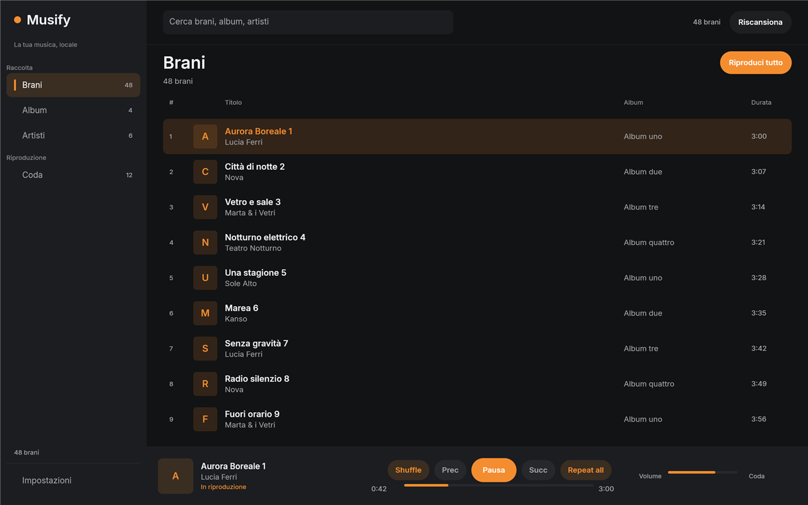
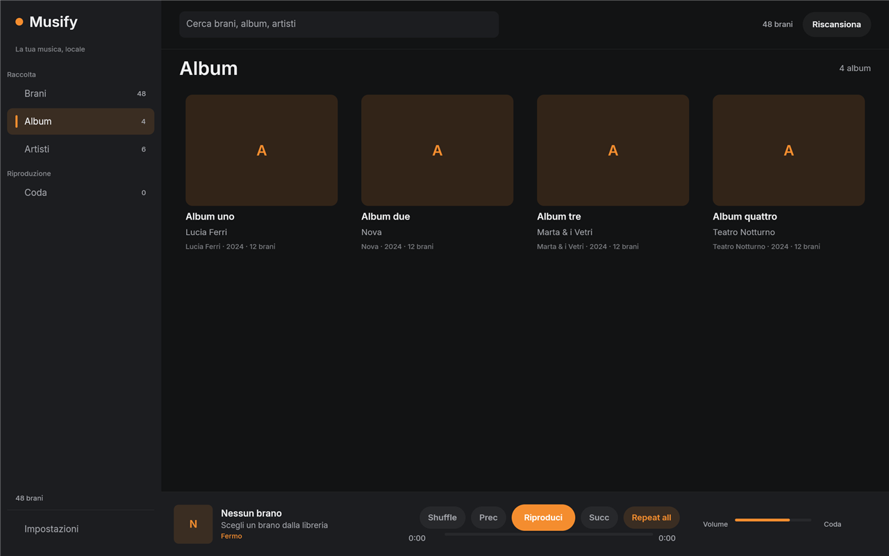
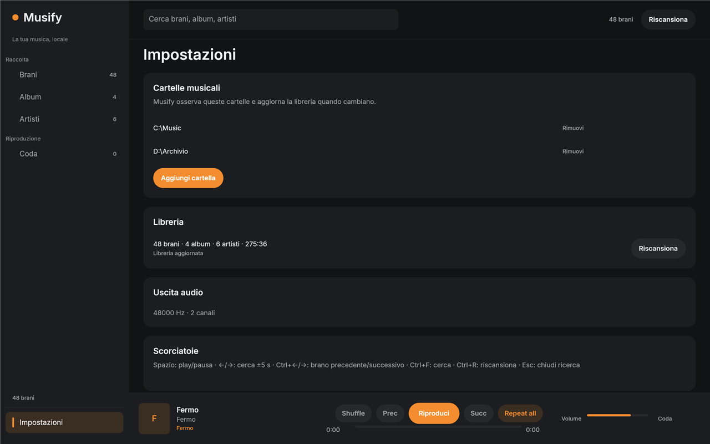
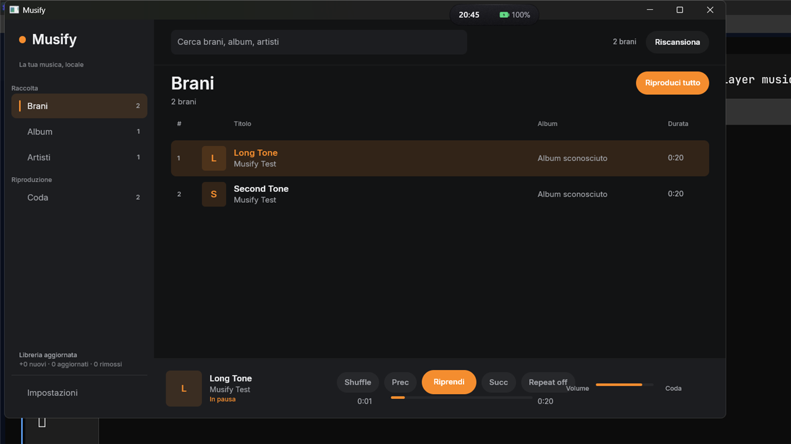

<p align="center">
  
</p>

<p align="center">
  <strong>Il tuo player musicale desktop per Windows.</strong><br>
  Leggero, locale, veloce. Costruito in Rust con una UI GPU Rune.
</p>

<p align="center">
  <a href="https://github.com/Marcu08/musify/actions/workflows/ci.yml"></a>
  
  
  
  
</p>

<p align="center">
  
</p>

## Musify in breve

Musify è un player musicale per Windows pensato per la **musica locale**:
cartelle scelte da te, scansione incrementale, copertine, ricerca istantanea,
coda, shuffle/repeat e una barra "in riproduzione" sempre pronta. Niente
abbonamenti, niente catalogo cloud, niente rumore: solo i tuoi file.

L'interfaccia è scura, con un accento ambra; il motore audio e la libreria sono
completamente separati dalla UI. Rune è una dipendenza sperimentale, pinnata a
un commit preciso e confinata al crate `musify-ui`.

## Funzionalità

- **Libreria locale**: cartelle musicali multiple, scansione incrementale,
  metadati con `lofty`, rimozione automatica dei file spariti.
- **Ricerca FTS5**: brani, album e artisti, con supporto agli accenti
  (`citta` trova `Città`).
- **Viste virtualizzate**: Brani, Album e Artisti costruiscono solo le righe
  visibili; la UI resta fluida anche con librerie grandi.
- **Riproduzione**: play/pausa, precedente/successivo, seek, volume,
  shuffle, repeat, coda modificabile.
- **Gapless**: i sample del brano successivo entrano nello stesso stream; il
  cambio metadati segue il confine di frame. Nessun crossfade.
- **Windows-native**: SMTC, overlay di Windows, tasti multimediali, dialog
  nativo per scegliere le cartelle.
- **Persistenza**: coda, brano corrente e posizione in `state.json`; cartelle,
  volume, shuffle e repeat in `config.toml`.
- **Scorciatoie**: Spazio, frecce, Ctrl+F, Ctrl+R, +/−, Esc, Ctrl+Q.
- **Misure trasparenti**: i numeri reali sono riportati sotto, inclusi i target
  che non sono stati raggiunti.

## Screenshot

| Brani | Coda |
| --- | --- |
|  |  |

| Album | Artisti |
| --- | --- |
|  |  |

| Ricerca | Impostazioni |
| --- | --- |
|  |  |

| Ripristino coda | Overlay Windows |
| --- | --- |
|  |  |

## Requisiti

- Windows 10/11 x86_64.
- [rustup](https://rustup.rs/) con toolchain MSVC. Il repository fissa
  **Rust 1.99.1** in `rust-toolchain.toml`, la stessa versione richiesta da Rune.
- Visual Studio Build Tools con **Desktop development with C++**.
- Driver GPU con DirectX 12 (Rune usa wgpu).
- Facoltativo: `ffmpeg` nel `PATH` per rigenerare gli asset audio di test.

## Avvio rapido

```powershell
git clone https://github.com/Marcu08/musify.git
cd musify

cargo build -p musify --release
.\target\release\musify.exe
```

Al primo avvio apri **Impostazioni → Aggiungi cartella**, scegli la cartella
della tua musica e lascia che la scansione parta. La libreria viene aggiornata
automaticamente quando i file cambiano.

Per lo sviluppo:

```powershell
cargo run -p musify
```

Controlli locali equivalenti alla CI:

```powershell
powershell -ExecutionPolicy Bypass -File .\scripts\ci.ps1
```

## Scorciatoie

| Tasto | Azione |
| --- | --- |
| `Spazio` | Play / pausa |
| `←` / `→` | Seek ±5 secondi |
| `Ctrl+←` / `Ctrl+→` | Brano precedente / successivo |
| `Ctrl+F` | Cerca |
| `Ctrl+R` | Riscansiona la libreria |
| `+` / `-` | Volume su / giù |
| `Esc` | Chiude ricerca o filtro |
| `Ctrl+Q` | Chiude Musify |

## Architettura

```text
┌──────────────────────┐   Command    ┌────────────────────┐
│      UI (Rune)       │ ───────────▶ │    AppBackend      │
│  liste virtuali      │              │  coda, config,     │
│  barra now-playing   │ ◀─────────── │  persistenza       │
└──────────────────────┘    Event     └─────────┬──────────┘
                                                │
                    ┌───────────────────────────┼───────────────────────────┐
                    ▼                           ▼                           ▼
             ┌────────────┐             ┌────────────┐             ┌────────────┐
             │ AudioEngine│             │  Library   │             │    SMTC    │
             │ symphonia  │             │  SQLite    │             │  souvlaki  │
             │ cpal/WASAPI│             │  FTS5      │             │  Windows   │
             └────────────┘             └────────────┘             └────────────┘
```

| Crate | Responsabilità |
| --- | --- |
| `musify-core` | tipi di dominio, `Command`/`Event`, trait `PlaybackSource` e `LibraryProvider` |
| `musify-audio` | decodifica, output, coda, seek, volume, gapless |
| `musify-library` | scanner incrementale, SQLite, ricerca, copertine, watcher |
| `musify-ui` | presentazione Rune, nessuna logica di dominio |
| `musify-spotify` | scheletro per la seconda sorgente (M5, opzionale) |
| `musify-app` | binario, config, cablaggio, SMTC, persistenza |

Dettagli completi in [ARCHITECTURE.md](ARCHITECTURE.md).

## Misure reali

Release, Windows 11, Ryzen 5 5625U (6 core / 12 thread), 7,9 GB RAM,
cache shader calda. Non sono numeri di laboratorio: sono le misure fatte su
questa macchina.

| Area | Risultato | Target indicativo |
| --- | --- | --- |
| Audio engine da solo | **0,93% di un core**, 15,9 MB, 0 underrun | < 2% |
| Resampler sinc 44,1 → 48 kHz | **1,25% di un core** (lineare: 0,31%), 0 underrun | < 2% |
| Libreria, 10.000 file | **8,51 s** prima scansione, **0,98 s** incrementale | — |
| UI a riposo | **0,00% CPU** su 5 s, nessun redraw | zero wake-up |
| UI in riproduzione | **8,27% di un core**, **0,69%** su 12 thread | < 2% |
| Avvio app completa | **1,09 s** mediana (min 1,08, max 2,11) | < 300 ms |
| RAM | **185 MB** working set a riposo, 187 MB in riproduzione | < 80 MB |

I target di **avvio** e **RAM** non sono stati raggiunti: Rune/wgpu e
l'inizializzazione GPU sono la parte dominante. La UI a riposo non ridisegna.
Tutti i dettagli e i problemi noti sono nei report delle milestone; il metodo e
i valori grezzi sono in [M45-BASELINE](docs/M45-BASELINE.md) e
[M45-FINAL](docs/M45-FINAL.md).

## Milestone

| Milestone | Stato | Report |
| --- | --- | --- |
| M0 — Workspace e smoke test Rune | completata | [M0](docs/M0-RUNE-REPORT.md) |
| M1 — Motore audio | completata | [M1](docs/M1-AUDIO-REPORT.md) |
| M2 — Libreria | completata | [M2](docs/M2-LIBRARY-REPORT.md) |
| M3 — UI Rune | completata | [M3](docs/M3-UI-REPORT.md) |
| M4 — Windows, SMTC, persistenza | completata | [M4](docs/M4-WINDOWS-REPORT.md) |
| M4.5 — Prestazioni e qualità locale | completata | [M4.5](docs/M45-REPORT.md) |
| M5 — Fonti online e radio internet | pianificata | — |

## Sviluppo

```powershell
# Tutti i test del workspace
cargo test --workspace --all-features

# Solo il motore audio
cargo test -p musify-audio

# Solo la libreria
cargo test -p musify-library

# CLI di prova
cargo run -p musify-audio --bin audio-cli -- .\crates\audio\tests\assets\tone.flac
cargo run -p musify-library --bin library-cli -- scan .\crates\audio\tests\assets
```

Gli asset audio di test sono minuscoli e già nel repository. Per rigenerarli:
`scripts/make-test-assets.ps1` (richiede ffmpeg).

Variabili utili per test isolati: `MUSIFY_DATA_DIR`, `MUSIFY_MUSIC_DIRS`
(separate da `;`), `MUSIFY_NO_AUDIO=1`, `MUSIFY_NO_SMTC=1`, `RUNE_READY_DIR`.

## Dati dell'applicazione

| File | Contenuto |
| --- | --- |
| `%APPDATA%\Musify\config.toml` | cartelle musicali, volume, shuffle, repeat |
| `%APPDATA%\Musify\state.json` | coda, brano corrente, posizione |
| `%APPDATA%\Musify\library.sqlite3` | indice della libreria |
| `%APPDATA%\Musify\covers\` | cache copertine JPEG |

## Limiti noti

- I target di avvio (< 300 ms) e RAM (< 80 MB) non sono centrati su questa
  macchina; i numeri reali sono sopra e i target realistici sono nel report
  M4.5.
- Su Windows a DPI 125% la prima finestra viene corretta al primo `on_ready`
  per allineare viewport e finestra nativa. L'ultimo `dev` di Rune è stato
  controllato: non contiene una correzione pertinente, quindi il rev resta
  pinnato e il workaround resta attivo.
- Il resampling è sinc (rubato) con fallback lineare tramite
  `MUSIFY_LINEAR_RESAMPLER=1`. Il costo CPU misurato è più alto del lineare ma
  resta sotto il 2% di un core per l'audio engine.
- Modificare o spostare la coda mentre il brano successivo è già decodificato
  ora svuota ring buffer e decodifica prima di riaprire il brano corrente; è
  coperto da test con un finto callback audio.
- Il dialogo nativo delle cartelle non è stato automatizzato nei test desktop;
  la configurazione via TOML e variabili d'ambiente è verificata. La checklist
  manuale è in [docs/MANUAL-CHECKLIST.md](docs/MANUAL-CHECKLIST.md).
- M5 è pianificata: fonti online generalizzate e radio internet. Il crate
  `musify-spotify` resta uno scheletro compilabile dietro feature `spotify`.

## Note legali

Musify è un progetto personale. Non aggira DRM, non registra e non distribuisce
flussi Spotify. L'eventuale uso di `librespot` per riprodurre contenuti Spotify
può non essere in linea con i termini di servizio di Spotify: valuta tu se
usarlo sul tuo account Premium. Nessun token o segreto viene salvato nel
repository o nei log.

## Crediti

Musify usa [Rune](https://github.com/anomalyco/rune) per la UI,
[Symphonia](https://github.com/pdeljanov/Symphonia) per la decodifica,
[cpal](https://github.com/RustAudio/cpal) per l'output,
[rusqlite](https://github.com/rusqlite/rusqlite) per la libreria,
[lofty](https://github.com/Serial-ATA/lofty-rs) per i metadati e
[souvlaki](https://github.com/Sinono3/souvlaki) per SMTC.

## Licenza

MIT — vedi [LICENSE](LICENSE).
